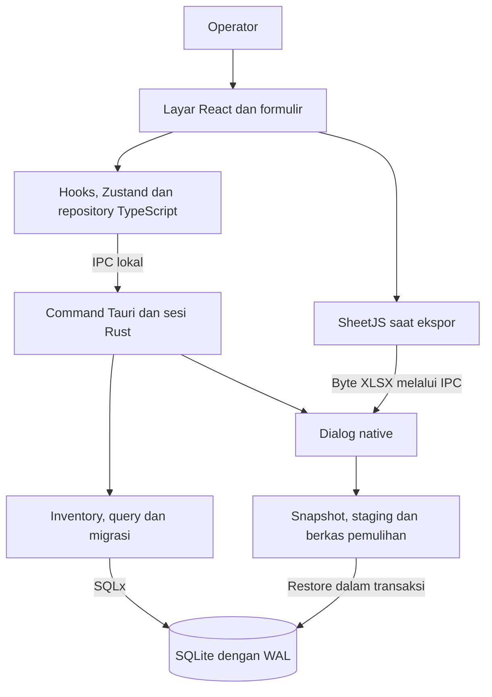

# Audit dan remediasi Stock Opname

## Ringkasan untuk pemilik

Pada baseline, satu transaksi yang gagal dapat mengubah saldo dan satu restore yang gagal dapat menghilangkan database aktif. Kedua jalur kini memiliki batas transaksi dan uji kegagalan. Pada fixture dengan saldo 10, hanya satu dari dua permintaan keluar masing-masing 7 yang berhasil. Pada fixture lain, hitung fisik mundur sebesar 2 diikuti penerimaan 4 menghasilkan saldo 6 setelah database dibuka kembali.

Rekomendasi per 28 November 2026 adalah pilot Windows dengan cadangan yang sudah berhasil dipulihkan dan direkonsiliasi. Data historis yang pernah tertimpa, konversi satuan lama yang tidak tercatat, dan adjustment lama tanpa arah tetap memerlukan keputusan pemilik. Dasar untuk melanjutkan secara bertahap adalah workflow offline, antarmuka repository, tabel virtual dan pemuatan layar sesuai kebutuhan yang sudah ada.

## Baseline 27 November 2026

Branch `update-cal-type-size`, commit `ae6033d2683c9ce90d56678743b29242cac183d4`. Saat pemeriksaan awal hanya dokumen instruksi yang untracked. Audit menggunakan sumber lokal, salinan build sementara, dan database sintetis.

| ID | Severitas dan bukti pada commit awal | Dampak dan hasil uji |
|---|---|---|
| DB-01 | Kritis, terkonfirmasi. `src-tauri/src/commands.rs:26,34`, `src/views/Layout.tsx:75` | Salinan utama kehilangan satu dari satu baris WAL yang sudah commit. Restore berkas teks dan salinan terputus pada fixture mengganti database yang sebelumnya dapat dibaca. |
| INV-01 | Tinggi, terkonfirmasi. `src/repositories/TransactionRepo.ts:83,151,248,331`, `src/stores/productStore.ts:116` | Dua OUT sebesar 7 dari saldo 10 meninggalkan saldo 3 dan total OUT 14. Kegagalan insert riwayat tetap menaikkan saldo. Pembuatan produk juga dapat melaporkan sukses sebagian. |
| INV-02 | Tinggi, terkonfirmasi. `src/repositories/TransactionRepo.ts:209,292,371` | Edit menghasilkan saldo 16 dengan snapshot berikutnya 14. Penghapusan adjustment lama menghilangkan baris tanpa membalik saldo. |
| INV-03 | Tinggi, terkonfirmasi. `src/repositories/db.ts:87`, `src/repositories/GlobalOpnameRepo.ts:38`, `src/views/StockOpname.tsx:135` | Merek kedua menimpa merek pertama pada tanggal yang sama. Tanggal sebelum pukul 07.00 WIB dapat masuk hari UTC sebelumnya. |
| INV-04 | Tinggi, terkonfirmasi. `src/views/StockTransactionPage.tsx:159`, `src/views/SalesReport.tsx:65` | Setelah mengganti BOX ke SIZE, tiga pasang terlihat tetapi lima tersimpan. Laporan menjumlahkan satuan yang berbeda. |
| AUTH-01 | Tinggi, terkonfirmasi. `src/stores/authStore.ts:16`, `src/repositories/AuthRepo.ts:15`, `src/repositories/db.ts:132`, `src-tauri/capabilities/default.json:10` | Status login berasal dari penyimpanan webview, hash masuk frontend, akun bawaan dibuat ulang. Sesi bertahan setelah simulasi restore. JSON rusak menyebabkan kegagalan startup. |
| DB-02 | Tinggi, terkonfirmasi. `src/repositories/db.ts:194,256`, `src/stores/productStore.ts:52`, `src/repositories/ProductRepo.ts:147` | Migrasi dapat melanjutkan setelah error dan membuat IN dari saldo sesudah adjustment. Edit metadata dapat mengganti tanggal dan catatan penerimaan biasa. |
| PERF-01 | Sedang, terkonfirmasi. `src/repositories/ProductRepo.ts:6`, `src/repositories/TransactionRepo.ts:47,447` | Pada 1.000, 10.000 dan 100.000 SKU, hasil yang terlihat adalah 1.000, 5.000 dan 5.000. Riwayat memuat seluruh 100.000 transaksi. EXPLAIN pada rekap bulanan menunjukkan scan transaksi. |
| SEC-02 | Sedang, risiko bersyarat. `src-tauri/tauri.conf.json:22`, `src/utils/excel.ts:18` | CSP kosong, akses generik SQL dan filesystem dari webview. Dampak kompromi webview besar. Tidak ada injeksi webview yang dibuktikan. Excel hanya mengekspor. Nilai menyerupai formula diuji sebagai sel teks. |

Build frontend lulus. ESLint menghasilkan empat peringatan. Cargo check, Clippy dan kedua tes reset lulus. Rustfmt menemukan satu selisih. npm audit menghasilkan 19 entri (15 high), dan 9 pada pohon omit-dev. OSV mencocokkan 28 dari 556 versi crate registry, termasuk advisory pemeliharaan dan dependensi platform lain. cargo-audit tidak terpasang. Status advisory tidak serta-merta berarti jalur terdampak aktif.

Keputusan pemilik mencakup satu verifikasi per merek per hari lokal, koreksi IN/OUT tetap tersedia, hitung fisik menjadi patokan saldo, delta bertanda untuk adjustment baru, dan migrasi akses SQL ke command native. Kebijakan penghapusan adjustment lama ditunda. Riwayat yang sudah hilang atau asal-usulnya ambigu tidak boleh diisi berdasarkan tebakan.

## Arsitektur dan batas kepercayaan setelah remediasi

Versi dari lockfile adalah React 19.2.3, TypeScript 5.8.3, Router 7.18.7, Vite 7.3.8, Zustand 5.0.10, Tailwind 4.1.18, Radix Label 2.1.8, TanStack Virtual 3.13.18 dan SheetJS 0.20.3. Backend menggunakan Tauri 2.12.7, SQLx 0.9.1, bcrypt 0.17 dan toolchain Rust 1.94.1.

| Area yang ditinjau | Tanggung jawab dan batas |
|---|---|
| `src/App.tsx`, `views`, `components` | Routing, form, tabel virtual, rekap, filter dan dialog konfirmasi. Layar meminta halaman data dan mengirim pilihan operator. |
| `hooks`, `stores`, `repositories`, `lib/quantity.ts`, `utils/excel.ts` | State tampilan, parsing jumlah, konversi satuan, penyusunan filter dan workbook. Repository memakai command bernama. Kredensial sesi dan handle SQLite berada di Rust. |
| `src-tauri/src/auth.rs`, `lib.rs`, konfigurasi dan capabilities | Pendaftaran akun pertama pada database kosong, verifikasi bcrypt, pergantian sandi bawaan, pembatasan percobaan login dan sesi dalam memori. ID pengguna untuk mutasi berasal dari sesi. Akun yang sudah masuk mempunyai fungsi operasional yang sama. |
| `database.rs`, `schema.sql`, `inventory.rs`, `queries.rs`, `stock_reset.rs` | Pool, penguncian profil, migrasi, query parametrik dan transaksi stok. Reset meminta sandi akun aktif, memakai akses eksklusif serta mempertahankan master data. |
| `commands.rs` | Dialog membatasi pemilihan berkas pada tindakan operator. Restore memeriksa objek skema, kolom, integritas fisik, foreign key dan nilai persediaan pada salinan sementara. Salinan pemulihan dibuat sebelum penggantian isi. |

Webview menerima data inventaris dan dapat meminta operasi sesuai sesi. Generic SQL, pemilihan path bebas dari JavaScript, dan hash hasil query pengguna sudah dihapus dari antarmuka frontend. Pemilik akses tulis ke profil OS tetap dapat mengganti berkas SQLite atau cadangan. File cadangan berisi data bisnis serta tabel akun. Aplikasi tidak menyediakan enkripsi database, pemisahan peran, atau audit log tahan perubahan. Berkas impor diperlakukan sebagai masukan eksternal. Kegagalan restore mempertahankan sesi dan data aktif. Restore berhasil mengakhiri sesi.

## Disposisi temuan dan pengujian regresi

Lokasi baseline serta akibat bisnis tercantum di tabel awal. Lokasi berikut memakai working tree final. Keyakinan tinggi berlaku untuk perilaku yang direproduksi pada fixture. Risiko bersyarat tetap dibedakan dari kejadian yang diamati.

| ID | Status akhir dan bukti implementasi | Skenario uji, usaha implementasi dan risiko regresi |
|---|---|---|
| DB-01 | Diperbaiki pada fixture Windows. `commands.rs:101` dan `:148` membuat snapshot WAL, memigrasikan staging, menyimpan recovery, lalu mengganti isi dalam satu transaksi. `:32` memeriksa angka, tipe dan relasi nilai persediaan. | Backup saat WAL aktif, impor berkas asing, sepuluh variasi nilai invalid, kegagalan di tengah insert, pemulihan dan buka ulang. Usaha besar, risiko tinggi untuk basis data berkustomisasi. |
| INV-01 | Diperbaiki. `inventory.rs:321` mengunci penulis dengan BEGIN IMMEDIATE. Saldo, transaksi dan stok pembukaan di-commit bersama. | Dua OUT bersamaan, stok kurang, angka di luar jangkauan, insert riwayat gagal dan produk gagal dibuat. Usaha sedang, risiko tinggi pada saldo. |
| INV-02 | Diperbaiki untuk IN/OUT dan adjustment baru. `inventory.rs:57`, `:111`, `:213` memvalidasi saldo awal, mengurutkan tanggal lalu ID dan menghitung ulang snapshot. Penghapusan adjustment lama tetap mengikuti kebijakan lama. | Edit termasuk sebelum hitung fisik, hapus delta positif/negatif, transaksi mundur, lalu restart. Riwayat ambigu memerlukan rekonsiliasi. Usaha besar, risiko tinggi. Alternatif transaksi kompensasi akan mengubah kebijakan operasional. |
| INV-03 | Diperbaiki. `database.rs:94` dan `queries.rs:282` memakai keunikan tanggal lokal dan merek, memeriksa saldo terkini dan menghitung IN/OUT per merek. Catatan opname merek menyimpan hasil verifikasi. | Dua merek pada hari sama, pengulangan merek pertama, pergantian hari dan ID hasil migrasi. Usaha sedang, risiko tinggi pada data legacy. |
| INV-04 | Diperbaiki untuk entri baru. `src/lib/quantity.ts:14`, `inventory.rs:147` dan `queries.rs:81` mempertahankan satuan pada transaksi, memisahkan rekap satuan dan mengabaikan input box saat memakai SIZE. Riwayat tanpa metadata memakai fallback merek yang tersedia. | Uji integer, overflow, BOX/SIZE, saldo nol, perubahan merek dan workbook setelah restart. Usaha sedang, risiko sedang pada label laporan lama. |
| AUTH-01 | Diperbaiki untuk batas aplikasi. `auth.rs:32`, `:61`, `:107`, `queries.rs:171`, `commands.rs:254`. Pemeriksaan sesi terjadi pada command native. | Setup awal, sandi salah, login, penolakan tanpa sesi, restore gagal/berhasil dan restart. Usaha besar, risiko sedang pada akun legacy. |
| DB-02 | Diperbaiki untuk skema standar. `database.rs:94` memakai user_version dan transaksi. `inventory.rs:256` membatasi perubahan tanggal/catatan pembukaan pada baris bertanda khusus. | Migrasi dua kali, verifikasi ID dan saldo tetap, riwayat kosong tetap kosong. Skema kustom memerlukan pemeriksaan tersendiri. Usaha sedang, risiko tinggi pada database lama. |
| PERF-01 | Diperbaiki pada daftar produk dan riwayat. `queries.rs:81` dan `src/hooks/usePagedQuery.ts:4` memakai filter, hitungan dan halaman di SQLite. Dashboard mengambil lima peringatan serta hitungan agregat. | Pada fixture 1.000, 10.000 dan 100.000, hitungan tepat dan halaman terakhir terjangkau. Ekspor 10.000 hasil melewati batas halaman. Usaha sedang, risiko sedang pada konsistensi filter. |
| SEC-02 | Permukaan akses dikurangi. `src-tauri/tauri.conf.json`, `capabilities/default.json` dan `commands.rs:261` membatasi sumber konten dan penulisan berkas. Dampak kompromi webview tetap merupakan risiko bersyarat. | Ekspor lewat dialog Windows, baca ulang tipe sel dan periksa catatan menyerupai formula. Usaha sedang, risiko sedang pada konfigurasi WebView platform lain. |

### Skema dan kompatibilitas

Migrasi versi 0 ke 1 menambahkan metadata yang belum ada untuk merek, ukuran, saldo awal ledger, tanda transaksi pembukaan, hitungan fisik, delta bertanda dan satuan historis. Tabel opname dengan keunikan tanggal lama disalin termasuk ID, kolom lama dan high-water mark urutan ID sebelum indeks unik tanggal/merek dibuat. Merek legacy kosong tetap kosong. Indeks baru mendukung urutan transaksi per produk, rentang tanggal dan pencarian merek.

Koreksi memerlukan saldo awal yang dapat dibuktikan dari urutan lama. Catatan opname yang sudah tertimpa sebelum migrasi hanya dapat dipulihkan dari sumber eksternal yang sah. Timestamp historis dengan zona waktu tidak diketahui dan satuan sebelum pencatatan metadata juga memerlukan verifikasi operator.

## Bukti verifikasi

| Pemeriksaan yang dijalankan | Hasil |
|---|---|
| `npm run build`, `npm test` | TypeScript dan Vite lulus. Dua tes Node lulus untuk parsing/konversi kuantitas dan round-trip XLSX termasuk pembatalan serta teks menyerupai formula. |
| `npm run lint` | Nol error, tiga warning. Dua mengenai kompatibilitas React Compiler dengan virtualizer, satu terkait Fast Refresh pada ekspor bersama. |
| `cargo fmt --manifest-path src-tauri/Cargo.toml -- --check`, `cargo check --locked`, `cargo clippy --all-targets --locked -- -D warnings` | Lulus dengan manifest aplikasi, toolchain yang dipatok dan Windows SDK pada PATH. |
| `cargo test --manifest-path src-tauri/Cargo.toml --locked` | Sembilan tes lulus. Tujuh tes fixture di `tests.rs` dan dua di `stock_reset.rs`. Kegagalan insert disuntikkan di fixture untuk menguji rollback. Penguncian sesi diuji saat operasi sedang aktif. |
| Build desktop `cargo build --features tauri/custom-protocol --bin stock-opname --locked` | Binary fixture Windows memakai identifier terpisah dan frontend hasil build. Dashboard serta layar riwayat berhasil dibuka sebelum dan setelah restart. |
| Filter dan ekspor pada WebView2 Windows | Dari tiga transaksi, rentang 2 Januari 2026 dan tipe ADJUSTMENT memilih satu. Setelah merek produk berubah menjadi BOX, baris tetap menunjukkan −1 Pasang. Workbook yang disimpan lewat dialog dibuka kembali. Timestamp adalah `02/01/2026 23:58`, jumlah −1 dan snapshot 2 bertipe numerik, catatan `=1+1` bertipe teks tanpa formula. |
| `npm audit` dan `npm audit --omit=dev` | Nol advisory pada kedua pohon. Perubahan meliputi pembaruan Router, Vite, TypeScript ESLint dan distribusi SheetJS resmi. |
| OSV, setiap versi registry di Cargo.lock | Enam dari 530 pasangan nama/versi cocok. Empat pemberitahuan pemeliharaan mencakup chrono, fxhash, pin-utils dan proc-macro-error. glib 0.18.5 memiliki advisory dan tidak muncul di pohon target Windows. rand 0.7.3 muncul melalui phf_generator pada build. Keterjangkauan kondisi advisory rand belum dibuktikan. cargo-audit tidak terpasang. Pemindaian mengirim koordinat paket publik. |
| Diff dan status | `git diff --check` lulus. Branch tetap pada commit baseline. Perubahan lokal mencakup manifest/lockfile, konfigurasi Tauri, modul native, repository, store, layar, komponen, tes dan laporan ini. Skrip dummy pemeriksa skema dihapus. Dokumen instruksi awal tetap berada di working tree. |

Pembaruan crate mencakup SQLx 0.9.1, cookie 0.18.3, event-listener 5.4.2, quick-xml 0.41.0, Tokio 1.53.3 dan url 2.5.9. Perubahan runtime, parser serta toolchain perlu diuji ulang pada sistem operasi yang akan didistribusikan. Daftar advisory dapat berubah sesudah tanggal audit. [API OSV untuk pemeriksaan versi](https://google.github.io/osv.dev/post-v1-querybatch/)

## Scorecard sebelum dan sesudah

Skor ordinal 0–10. Nilai 3–4 menunjukkan kegagalan yang dapat direproduksi pada alur utama, 5–6 menunjukkan kontrol parsial, dan 7–8 menunjukkan kontrol serta bukti regresi pada platform uji. Nilai 9–10 memerlukan bukti operasional yang lebih luas.

| Kategori | Awal | Akhir | Dasar penilaian |
|---|---:|---:|---|
| Keamanan | 4 | 7 | Capability dipersempit, CSP aktif dan akses berkas melalui dialog. Akses lokal OS tetap berpengaruh. |
| Autentikasi dan otorisasi | 3 | 7 | Sesi native dan atribusi pelaku telah diuji. Hak operasi bersifat seragam bagi akun yang masuk. |
| Arsitektur | 5 | 8 | UI dan repository dipertahankan. Rust memiliki transaksi, sesi dan koneksi. |
| Kualitas kode | 5 | 7 | Pemeriksaan tipe dan Clippy lulus. Sejumlah query panjang dan tiga warning ESLint tersisa. |
| Integritas database | 3 | 8 | Penulis serial, migrasi atomik, verifikasi staging dan uji rollback. Skema kustom belum tersertifikasi. |
| Ketepatan logika bisnis | 4 | 7 | Hitung fisik, satuan dan merek per hari teruji. Kualitas histori lama membatasi rekonstruksi. |
| Keandalan dan pemulihan | 3 | 7 | WAL, salinan recovery dan restart teruji. Simulasi kehilangan daya fisik belum dijalankan. |
| Kinerja | 5 | 7 | Paging mencakup 100.000 baris. Pencarian substring dan pembuatan workbook besar tetap menggunakan sumber daya sesuai ukuran hasil. |
| Kemudahan pemeliharaan | 5 | 7 | Domain terpusat dan regresi dapat diulang. Modul query serta UI laporan masih memerlukan pemeliharaan bersama. |
| Cakupan uji | 3 | 6 | Sembilan tes Rust dan dua tes frontend disertai smoke test desktop. Otomasi desktop belum masuk suite CI. |
| Kesiapan produksi | 3 | 6 | Pilot Windows layak setelah latihan restore. Rehearsal migrasi dan penerimaan operator diperlukan untuk rollout bisnis. |

## Roadmap dan keputusan rilis

| Prioritas | Pekerjaan, dependensi dan manfaat | Usaha / risiko regresi |
|---|---|---|
| P0, diterapkan | Setelah akses native tersedia, transaksi saldo/riwayat di inventory dan snapshot/staging di commands menutup kegagalan saldo parsial dan restore. | Besar / tinggi. Ulangi uji transaksi bersamaan dan restore setiap rilis. |
| P1, diterapkan | Sesi di auth, reset eksklusif, migrasi versi di database dan opname merek/hari di queries mengikuti keputusan pemilik. | Besar / tinggi. Uji akun lama, saldo awal, hitung fisik dan referensi master. |
| P1, sebelum rollout | Operator memilih salinan representatif yang disetujui untuk latihan migrasi dan rekonsiliasi. Pemilik menetapkan perlakuan adjustment lama jika kebijakannya akan diubah. | Sedang / tinggi. Catat saldo, jumlah baris dan selisih per merek sebelum dan sesudah. |
| P2 | Pertahankan fixture regresi. Otomatiskan smoke test WebView2 dan uji installer di mesin Windows bersih. Validasi Linux/macOS bila masuk target distribusi. | Sedang / sedang. Bergantung pada mesin serta installer target. |
| P3 | Profilkan ekspor dan pencarian pada volume operasional. Pertimbangkan streaming ekspor atau indeks pencarian khusus jika konsumsi memori atau waktu respons menghambat operator. | Sedang / sedang. Ukur ulang sebelum mengganti implementasi. |

Lima perubahan dengan dampak terbesar adalah transaksi atomik untuk stok dan riwayat, backup/restore konsisten terhadap WAL, perhitungan ulang yang mempertahankan observasi fisik, atribusi pengguna di Rust, serta pemisahan opname per merek dan tanggal lokal. Refactoring bertahap sudah mencakup jalur kritis dan tetap mendukung alur offline.

### Checklist penerapan dan rollback untuk operator

1. Sebelum membuka profil dengan binary baru, hentikan input pada versi lama dan buat snapshot SQLite konsisten yang mencakup transaksi WAL. Gunakan mekanisme SQLite backup atau VACUUM INTO melalui alat yang disetujui. Salin hasilnya ke lokasi terpisah, periksa integritas, buka di profil uji dan cocokkan jumlah data serta saldo. [Dokumentasi snapshot SQLite](https://www.sqlite.org/lang_vacuum.html#vacuuminto)
2. Jalankan migrasi pada salinan tersebut, simpan salinan pra-migrasi, lalu uji login, stok awal, IN/OUT, perubahan historis, hitung BOX/SIZE, dua merek pada hari yang sama, ekspor dan restore. Periksa tanggal di sekitar tengah malam pada zona waktu lokasi. Cocokkan sampel dengan catatan operator.
3. Uji penolakan restore dan pembatalan dialog, alur reset bersandi pada salinan sekali pakai, ruang disk, hak akses direktori, dan installer pada mesin target. Uji dampak listrik padam, filesystem jaringan dan antivirus bila relevan untuk lingkungan toko.
4. Jika pilot harus dibatalkan, hentikan transaksi dan simpan snapshot versi baru serta daftar perubahan sesudah migrasi. Jalankan versi lama pada profil terpisah yang dipulihkan dari snapshot pra-migrasi. Rekonsiliasi transaksi selama pilot sebelum kembali beroperasi. Simpan kedua salinan sampai operator mengesahkan saldo.

Seluruh perubahan berada di working tree lokal. Tidak ada commit, push, merge atau pull request. Pengujian memakai database sintetis. Workbook fixture yang sempat disimpan dialog ke folder terakhirnya dipindahkan ke direktori QA sementara setelah isi diverifikasi. Profil dan artefak sintetis tersedia untuk pemeriksaan ulang.

